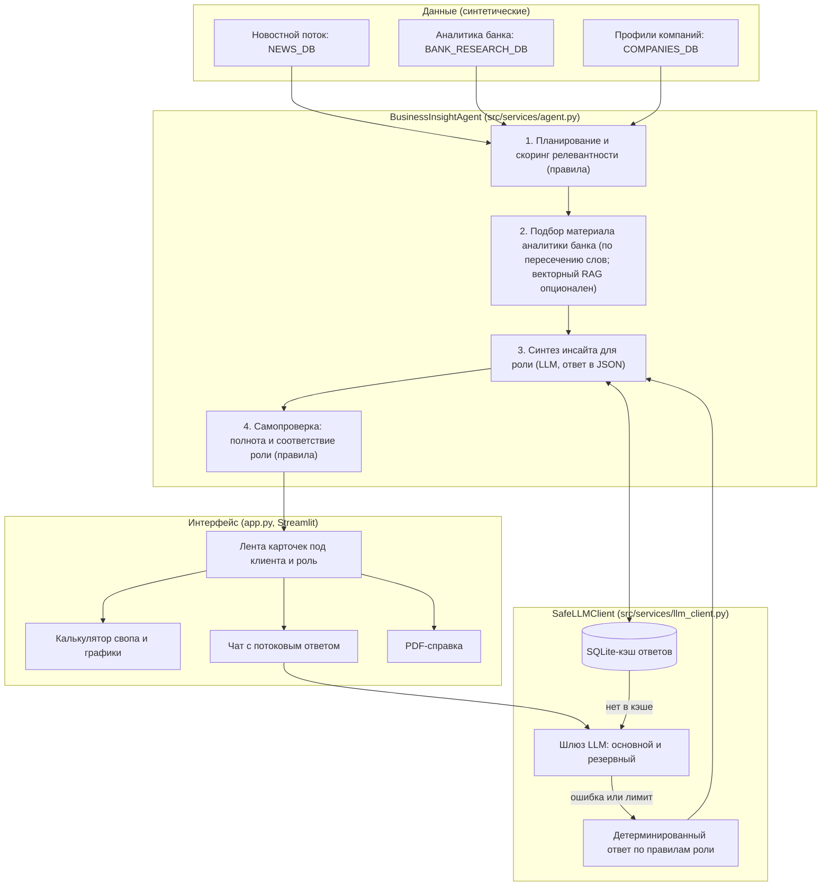

# Альфа-Инсайт: новостная аналитика для принятия бизнес-решений

Персонализированный сервис в контуре интернет-банка «Альфа-Бизнес» для лиц, принимающих решения (ЛПР), в крупных компаниях (выручка свыше 15 млрд ₽). Сервис берёт рыночные новости и макро-аналитику банка и для каждого клиента и каждой роли отвечает на три вопроса: что произошло, чем это грозит именно этой компании и что делать.

**Демо-стенд:** https://alfabankhackaton-fxf5a5wsdu4quzw8wwlgyk.streamlit.app

**Версия для проверки:** commit `<v1.0.0>`, ветка `main`.

> Все данные о компаниях, платежах и контрагентах синтетические. Настоящих клиентских данных в решении нет.

---

## Что умеет сервис

1. **Лента под клиента.** Для выбранной компании события из новостного потока ранжируются по релевантности её профилю: отрасль (ОКВЭД), кредитные и лизинговые продукты, участие во ВЭД, связи с контрагентами. События ниже порога релевантности в ленту не попадают.
2. **Ролевая интерпретация.** У каждой из четырёх ролей свои риски, шаги, быстрые вопросы и продукт банка:
   - **CEO**: маржа, цепочка поставок, цены и инвестпрограмма.
   - **CFO**: ковенанты (Net Debt/EBITDA, ICR), стоимость обслуживания долга, процентный своп (IRS).
   - **Руководитель казначейства**: платёжный календарь, кассовые разрывы, овернайты и депозиты, расчёты по ВЭД.
   - **Главный бухгалтер**: ФСБУ 25/2018 (аренда и лизинг), отчётность, документы и валютный контроль по ВЭД.
3. **Разделение позиции банка и вывода ИИ.** В каждой карточке отдельно показаны позиция аналитиков банка (со ссылкой на материал) и персональный вывод модели для предприятия.
4. **Калькулятор процентного свопа.** Ползунки «сумма транша» и «ставка свопа»; результат: платёж до и после, экономия в млн ₽ в месяц, год и за срок свопа. Формула: сумма × (ставка + спред) ÷ 12. Рядом графики: ключевая ставка по сценариям на 2027 год и стоимость обслуживания транша с хеджем и без.
5. **Чат с AI-аналитиком.** Ответ выводится по мере генерации (потоковый вывод). У каждой роли свои быстрые вопросы. Диалог учитывает последние реплики.
6. **Краткая справка для руководителя.** Кнопка скачивания справки на одну страницу: событие, риск, действие, продукт банка и расчёт свопа (PDF; если нет шрифта или `reportlab`, выдаётся TXT).
7. **Прозрачность.** В каждой карточке есть аудит-лог: шаги агента, использованные источники и модели.
8. **Отказоустойчивость.** Если шлюз с моделями недоступен, сервис не падает и не прячет проблему. Над лентой стоит индикатор режима: «в реальном времени», «часть аналитики по правилам», «режим без LLM», «офлайн».

---

## Архитектура



Шаги 1 и 4 выполняются правилами в коде, без вызова модели. Модель вызывается на шаге 3 (синтез инсайта) и в чате. Если модель недоступна, шаг 3 возвращает заготовленный ответ для роли, а индикатор над лентой честно показывает режим.

### Структура репозитория

| Путь | Назначение |
|---|---|
| `app.py` | Интерфейс Streamlit: лента, калькулятор, чат, PDF |
| `src/api/main.py` | Сборка данных и агента (`COMPANIES_DB`, `NEWS_DB`, `BANK_RESEARCH_DB`, `agent`) |
| `src/services/agent.py` | Многошаговый агент и ролевые наборы (`ROLE_PERSONAS`) |
| `src/services/llm_client.py` | Клиент моделей: белый список, кэш, повторы, резервный шлюз |
| `src/services/synthetic_generator.py` | Генерация синтетических данных |
| `src/services/rag_store.py` | Векторный поиск по аналитике (включается `ALFA_USE_RAG=1`) |
| `src/models/schemas.py` | Схемы данных (Pydantic) |
| `data/` | Кэш ответов моделей `llm_cache.sqlite` (создаётся при запуске) |

---

## Запуск

### Вариант 1. Docker (рекомендуется для проверки)

```bash
cp .env.example .env        # впишите LLM_API_KEY (см. ниже)
docker compose up --build
```

Приложение откроется на http://localhost:8501.

### Вариант 2. Локально

Требуется Python 3.11.

```bash
python -m venv .venv && source .venv/bin/activate
pip install -r requirements.txt
cp .env.example .env        # впишите LLM_API_KEY
streamlit run app.py
```

### Переменные окружения

Секреты берутся из `.env`, переменных окружения или `st.secrets` (для Streamlit Cloud: Settings → Secrets). В репозитории ключей нет.

| Переменная | Назначение | По умолчанию |
|---|---|---|
| `LLM_API_KEY` | Ключ шлюза моделей | пусто (режим без LLM) |
| `LLM_BASE_URL` | Адрес основного шлюза (OpenAI-совместимый) | `https://changellenge.up.railway.app/v1` |
| `LLM_BACKUP_URL` | Резервный шлюз | `https://api.alfahack-gateway26.ru/v1` |
| `LLM_MODEL` | Основная модель шлюза | `deepseek/deepseek-v4.1-flash` |
| `LLM_MODEL_REASONING`, `LLM_MODEL_UNIVERSAL`, `LLM_MODEL_RESEARCH` | Модели по назначению | см. `llm_client.py` |
| `LLM_TIMEOUT` | Таймаут запроса, с | `45` |
| `LLM_MAX_CONCURRENCY` | Одновременных запросов к шлюзу | `3` |
| `ALFA_USE_RAG` | `1` включает векторный поиск (`rag_store`) | выключено |

**Без ключа сервис всё равно запускается:** лента и роли работают на правилах, над лентой будет жёлтая плашка «Режим без LLM». Чтобы увидеть живые ответы моделей, укажите `LLM_API_KEY`.

---

## Сценарий проверки (5 минут)

1. Откройте стенд или запущенное приложение. Откройте меню слева («Меню банка», если шторка свёрнута).
2. Над лентой посмотрите индикатор режима. С ключом: «Аналитика сформирована AI-агентом в реальном времени».
3. **Клиент.** Переключите организацию («УралМеталлЭкспорт» и «Федеральная Торговая Сеть Прайм»): лента, ОКВЭД, долг и события меняются.
4. **Роль.** Для одного клиента по очереди выберите CFO, казначей, главбух, CEO. Меняются риски, шаги, продукт банка и быстрые вопросы под чатом.
5. **Карточка.** Проверьте блоки: что произошло (ссылка на источник), почему важно, риски и возможности, позиция банка и вывод ИИ, шаги (чек-боксы), продукт.
6. **Калькулятор.** В карточке о ключевой ставке двигайте «Сумма транша» и «Ставка свопа»: платёж до и после, экономия и графики пересчитываются.
7. **PDF.** Нажмите «Скачать краткую справку»: одностраничная справка с расчётом свопа.
8. **Чат.** Нажмите быстрый вопрос или задайте свой. Ответ появляется постепенно. Внизу страницы выбирается событие, к которому относится чат.
9. **Аудит-лог.** Раскройте блок «Аудит-лог и происхождение выводов»: шаги агента, источники, модели.
10. **Отказоустойчивость.** Запустите без `LLM_API_KEY`: сервис работает, индикатор честно показывает режим без LLM.

В боковой панели есть переключатель «Диагностика ИИ»: счётчики ответов модели (live / cached / fallback), последняя модель и последняя ошибка шлюза, кнопка «Проверить шлюз».

---

## Работа с моделями и безопасность

- **Белый список моделей.** `ALLOWED_MODELS` в `llm_client.py` содержит модели из регламента. Запрос к модели вне списка отклоняется. В коде вызываются модели GLM-5.3-Flash (синтез), Qwen3.6 35B A3B (чат и обработка), DeepSeek-V4.1-Flash (основная модель шлюза). Остальные модели списка (Gemma, Kimi, Qwen3-VL) в текущей версии не вызываются.
- **Идентификаторы клиентов.** Профили передаются под псевдонимами вида `U_1001`. Настоящих названий и реквизитов в запросах к моделям нет.
- **Кэш.** Ответы моделей кэшируются в SQLite по хэшу запроса, чтобы не тратить лимит на повторы.
- **Отказоустойчивость шлюза.** Один повтор при 429 и 5xx, переход на резервный шлюз при сетевой ошибке, остановка перебора моделей при ошибке ключа или лимита (401, 402, 403).
- **Ограничение на число одновременных запросов** к шлюзу снижает риск 429 при построении ленты.
- **Ответственность.** Справка и расчёты ориентировочные и не являются офертой. В интерфейсе заявка на продукт передаётся банкиру; решение принимает человек.

---

## Ограничения текущей версии

- Данные компаний, платежей и событий синтетические; часть событий заготовлена.
- Сценарии ключевой ставки на 2027 год иллюстративные, базовый откалиброван на средний прогноз аналитиков банка (12,5%). Ключевая ставка в расчётах задана константой, а не подтягивается с сайта ЦБ.
- Подбор материала аналитики банка на шаге 2 использует пересечение слов; полноценный векторный поиск включается отдельно (`ALFA_USE_RAG=1`) и в демо отключён.
- Самопроверка на шаге 4 состоит из правил (полнота блоков, соответствие роли), а не из отдельного вызова модели.
- Бухгалтерские формулировки по ФСБУ 25/2018 общие и не заменяют консультацию специалиста.

---

## Лицензии и сторонние компоненты

Перечень библиотек, моделей и шрифтов: [THIRD_PARTY_NOTICES](THIRD_PARTY_NOTICES).
