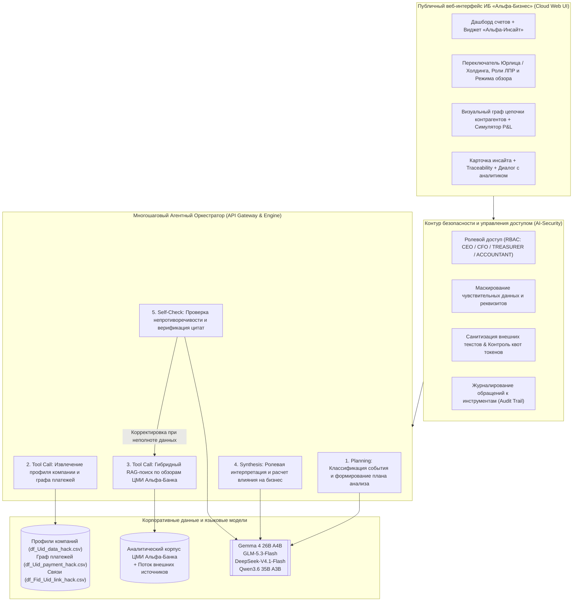

# Альфа-Инсайт — Интеллектуальная новостная аналитика для крупного бизнеса

**Альфа-Инсайт** — аналитический веб-сервис в контуре интернет-банка **«Альфа-Бизнес»**, предназначенный для руководителей и лиц, принимающих решения (ЛПР) в компаниях крупного корпоративного сегмента (выручка свыше 15 млрд ₽).

Сервис трансформирует поток внешних рыночных новостей, регуляторных изменений и аналитических обзоров **Центра макроэкономических исследований (ЦМИ) Альфа-Банка** в персонализированные бизнес-инсайты. Вместо общего пересказа событий система рассчитывает прямое и косвенное влияние новости на конкретную компанию с учетом ее отрасли (ОКВЭД), структуры кредитного и лизингового портфеля, внешнеэкономической деятельности (ВЭД) и графа расчетов с контрагентами.

---

## О проекте и ключевой ценности для бизнеса

Руководители крупных компаний ежедневно сталкиваются с информационным шумом, где сложно отделить общие макроэкономические тренды от факторов, непосредственно влияющих на маржинальность, цепочки поставок или ликвидность бизнеса.

**Альфа-Инсайт решает три ключевые задачи:**
1. **Персонализированный отбор и ранжирование:** Сопоставляет каждое событие с цифровым профилем клиента, его положением в отрасли и графом плательщиков/получателей, выводя в приоритет только значимые изменения.
2. **Ролевая интерпретация для ЛПР:** Адаптирует акценты, оценку рисков и чек-лист рекомендуемых шагов под конкретную роль пользователя в компании:
   - **Генеральный директор (CEO):** стратегическое влияние на долю рынка, инвестиционную программу (CAPEX) и устойчивость холдинга.
   - **Финансовый директор (CFO):** влияние на долговую нагрузку, выполнение ковенант, маржинальность (EBITDA) и оборотный капитал.
   - **Руководитель казначейства (TREASURER):** управление текущей ликвидностью, процентные и валютные риски, маршрутизация трансграничных платежей (CNY/RUB).
   - **Главный бухгалтер (ACCOUNTANT):** комплаенс, валютный и таможенный контроль, резервирование по дебиторской задолженности.
3. **Разделение банковской экспертизы и AI-аналитики:** В каждой карточке события явно разграничены официальная позиция аналитиков ЦМИ Альфа-Банка (с точными цитатами и ссылками на макро-обзоры) и расчетный прогноз AI-модели, сгенерированный специально под параметры клиента.

---

## Пользовательский интерфейс в экосистеме «Альфа-Бизнес»

Интерфейс спроектирован в модульной Bento-эстетике с использованием системной типографики **San Francisco (SF Pro)** и приглушенной платиново-графитовой палитры:

- **Точка входа на главном экране:** Постоянно доступный сигнальный виджет в верхней части корпоративного дашборда рядом с остатками по расчетным (RUB), валютным (CNY) счетам и параметрами долгового портфеля.
- **Паспорт цифрового профиля и интерактивный граф цепочки контрагентов:** Наглядная индикация активных бизнес-факторов компании (ОКВЭД, масштаб выручки, география ВЭД) и визуальная схема финансовых потоков `Покупатели (PAYER) → Компания → Поставщики (BENEFICIARY)` с цветовой индикацией узлов, попадающих под влияние новостей.
- **Два режима обзора (`Полный разбор` / `Кратко Executive`):** Возможность мгновенно переключаться между глубокой шестиблочной аналитикой и компактным дашбордом для быстрого принятия решений за 30 секунд.
- **Шестиблочная структура аналитической карточки:**
  1. **Что произошло:** Выверенные факты, ключевые цифры и прямая ссылка на первоисточник без предположений.
  2. **Почему это важно для компании:** Объяснение связи события с конкретными продуктами и контрагентами клиента + сработавшие триггеры профиля.
  3. **Возможные последствия:** Структурированное разделение на **Ключевые риски** и **Окна возможностей**.
  4. **Экспертная позиция Альфа-Банка vs Персональный вывод AI-модели:** Сопоставление подтвержденного макро-взгляда банка и индивидуального расчета чувствительности бизнеса клиента.
  5. **Рекомендуемые действия и предзаполненный Term Sheet продукта:** Прикладной чек-лист шагов для выбранной роли ЛПР и нативная интеграция релевантного банковского решения (Процентный своп IRS, Факторинг, Прямые расчеты в CNY, Выпуск ЦФА «А-Токен») с возможностью подписания заявки КЭП.
  6. **Трассируемость выводов (Traceability):** Визуальный таймлайн выполнения шагов AI-агента, задействованные поля корпоративного профиля и проверенные источники.
- **Интерактивный калькулятор финансового эффекта (P&L и Cash Flow Симулятор):** Сценарное моделирование потенциальных потерь и прямой экономии в млн ₽ при подключении инструментов хеджирования Альфа-Банка.
- **Интерактивный диалог с AI-аналитиком:** Встроенный модуль уточняющих вопросов внутри каждого инсайта для пересчета сценариев в нужном разрезе.
- **Анализ произвольного внешнего события:** Инструмент оперативной проверки любой новой новости или регуляторного документа в реальном времени.

---

## Архитектура и многошаговая агентная логика

Система построена на собственной мультиагентной оркестрации, выполняющей полный цикл подготовки аналитики — от декомпозиции текста до самопроверки фактов:



### Этапы работы агентного пайплайна:
1. **Планирование (`Planning`):** Первичная классификация информационного материала, выделение сущностей (отрасли, валюты, инструменты ДКП, география) и определение набора необходимых инструментов.
2. **Обращение к инструментам (`Tool Execution`):**
   - **Профайлер клиента и графа связей:** Извлекает параметры юридического лица (`MAINOKVED_CODE`, `REVENUE_COMPANY`, `FTS_FLAG`, `FTS_COUNTRY_NAME`, продуктовые флаги `CL_PRODUCT_*_MARK`) и анализирует структуру оборотов по базе платежей (`PAYER` / `BENEFICIARY`, `PAY_AMT`, `PAY_CNT`).
   - **Поисковый контур Alfa-RAG:** Выполняет семантический и ключевой поиск по аналитическим материалам ЦМИ Альфа-Банка для извлечения релевантной позиции банка.
3. **Синтез в едином контексте (`Context & Synthesis`):** Агрегация фактов первоисточника, макро-оценки банка и микро-контекста компании в структурированный JSON-ответ с учетом роли ЛПР.
4. **Самопроверка и адаптация (`Self-Check & Adaptation`):** Контрольный шаг проверяет отсутствие фактологических искажений, наличие ссылок на первоисточники и корректное отделение мнения банка от выводов модели. При обнаружении пробелов в контексте инициируется повторный уточняющий запрос к базе знаний.

### Используемые языковые модели:
- `Gemma 4 26B A4B` — быстрая классификация входящего потока, фильтрация дубликатов и извлечение сущностей.
- `GLM-5.3-Flash` — многошаговое планирование, глубокие причинно-следственные рассуждения и финансовый анализ.
- `DeepSeek-V4.1-Flash` — исследование связей в графе контрагентов и оценка каскадного влияния на цепочки поставок.
- `Qwen3.6 35B A3B` — генерация структурированной интерпретации и ролевая адаптация рекомендаций.
- `Qwen3-VL-30B-A3B-Instruct` и `Kimi-K2.6` — разбор аналитических иллюстраций и суммаризация объемных отчетов.

---

## Безопасность AI-компонентов (AI-Security & Governance)

В архитектуру заложены многоуровневые механизмы защиты корпоративных данных:

1. **Разграничение прав доступа (RBAC):** Пользователь получает доступ исключительно к данным своей организации/группы компаний, а глубина финансовых рекомендаций фильтруется в соответствии с ролью ЛПР.
2. **Защита чувствительных данных:** В языковые модели передаются только обезличенные синтетические идентификаторы (`SYNTHETIC_U`, `SYNTHETIC_F`) и агрегированные признаки без раскрытия банковской тайны, ИНН и платежных реквизитов.
3. **Контроль и журналирование инструментов:** Каждое обращение агента к профилю клиента или базе отчетов фиксируется в аудит-логе с уникальным `trace_id`.
4. **Защита от Prompt Injection и небезопасных действий:** Тексты внешних новостей проходят санитизацию и обрабатываются в изолированном контейнере данных. Агент функционирует в режиме `Read-Only Advisor` и технически не имеет доступа к самостоятельному проведению банковских транзакций — любое продуктовое действие подтверждается пользователем.

---

## Масштабирование и мониторинг качества

### Масштабирование решения:
- **Новые отрасли и сегменты клиентов:** Правила чувствительности ОКВЭД и продуктовые триггеры вынесены в декларативные конфигурации, что позволяет подключать новые отрасли и сегменты (включая средний бизнес) без переписывания ядра системы.
- **Новые источники данных:** Модульная архитектура адаптеров позволяет подключать внешние ленты информагентств, регуляторные порталы и внутренние репозитории аналитики банка.

### Метрики и цикл обратной связи (Human-in-the-Loop):
- **Качество контента (`Faithfulness Score >= 98%`):** Автоматическая верификация соответствия выводов первоисточникам и материалам ЦМИ Альфа-Банка.
- **Точность персонализации (`Precision@3 >= 90%`):** Сбор пользовательских оценок («Полезно» / «Скрыть похожие») непосредственно в карточке инсайта для динамической калибровки весов ранжирования под конкретную роль.
- **Бизнес-эффективность (`Action Conversion Rate`):** Мониторинг конверсии из чтения аналитики в целевые продуктовые заявки (хеджирование, факторинг, ВЭД, ЦФА).

---

## Доступ к сервису и развертывание в облаке

### Публичная веб-версия
Решение размещается как публичное облачное веб-приложение, доступное из любого браузера без необходимости локальной установки окружения:
- Веб-интерфейс открывается напрямую по публичной ссылке развернутого стенда.

### Развертывание на внешнем облачном сервере (Docker Compose)
Для автоматического развертывания релизной сборки на любом облачном VDS/VPS или в корпоративном кластере используется единая конфигурация контейнеров:
```bash
docker compose up --build -d
```

---

## Сценарий демонстрации возможностей

1. **Главный экран и точка входа:** Откройте публичную веб-страницу сервиса. В верхней части корпоративного дашборда отображаются балансы по расчетным (RUB) и валютным (CNY) счетам компании, параметры долгового портфеля и сигнальный виджет **«Альфа-Инсайт»**.
2. **Динамическая персонализация и граф цепочки поставок:**
   - Переключите юридическое лицо в верхней панели (например, с металлургического холдинга **АО «УралМеталлПром»** на логистического оператора **ООО «ТрансЛогистик Восток»**). Обратите внимание на обновление цифрового паспорта компании, интерактивной карты цепочки контрагентов и перестройку приоритетов в ленте событий.
   - Измените роль руководителя (`CFO` -> `TREASURER` -> `CEO` -> `ACCOUNTANT`), чтобы увидеть адаптацию фокуса события, чек-листа рекомендуемых действий и предлагаемого банковского инструмента.
   - Протестируйте переключение режима обзора между `Полный разбор` и `Кратко (Executive)`.
3. **Глубина интерпретации, финансовый симулятор и прозрачность (Traceability):**
   - Изучите карточку инсайта: сравните плашку **«Экспертная позиция Альфа-Банка»** и **«Персональный вывод AI-модели»**.
   - Откройте **«Интерактивный калькулятор финансового эффекта (P&L и Cash Flow Симулятор)»**, чтобы смоделировать экономию в млн ₽ при подключении хеджирующих продуктов банка.
   - Нажмите на кнопку целевого банковского продукта для открытия предзаполненного паспорта сделки (**Term Sheet**).
   - Раскройте блок **«Цепочка рассуждений AI-модели и источники данных (Traceability)»** для просмотра визуального пайплайна шагов агента и задействованных признаков компании.
4. **Интерактивный диалог с аналитиком:** Откройте вкладку **«Задать уточняющий вопрос AI-аналитику»** внутри карточки и протестируйте быстрые аналитические пресеты или введите собственный запрос.
5. **Проверка на новых событиях:** В левом меню перейдите в раздел **«Анализ внешнего события»**, вставьте текст любой произвольной новости и сформируйте полный персональный разбор в реальном времени.
